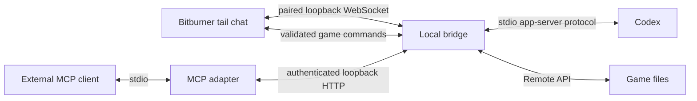

# Bitburner Bridge

An in-game conversation window backed by a local Codex process, with live game tools and an optional MCP interface.

Ask what your automation is doing, inspect a script, or propose a change without switching out of Bitburner. Replies stream into a native tail window. Game actions have visible approval cards and an activity log; a successful reply is not treated as proof that an action completed.

**Status: early local-only release.** Verified on Bitburner Steam 3.0.1 and Codex CLI 0.166.0-alpha.5.1 on Windows. Codex dynamic tools are experimental; other versions and platforms need validation. This project is independent of OpenAI and the Bitburner maintainers.

## What works

- In-game chat with streamed replies, follow-up questions, cancellation and connection indicators.
- Live balance, hacking level, network capacity, server access and process inspection.
- Read game scripts; propose JavaScript writes under `assistant/`, start scripts on home, or stop a specific PID.
- Approval of the exact mutation inside the game, before execution. Existing scripts are backed up before replacement.
- A shared tool contract for the chat client and a standards-based MCP stdio server.
- Separate conversation history stored locally; a service restart resumes the bridge's own Codex thread.

It does not attach to an existing desktop conversation. Existing hacking automation continues independently. There are no direct reset, augmentation-install or save-editing tools. Ordinary game API unlocks and RAM costs still apply.

## Requirements

- Node.js 22 or newer and npm.
- Bitburner Steam with Remote API support.
- A working `codex` CLI on PATH, signed in using the official Codex login flow. If needed, set `CODEX_BIN` to the executable path.
- Approximately **39 GB free RAM on home** for `bridge.js` in the tested game version.

Model usage goes through your configured Codex account/provider and its normal limits. The bridge never reads, copies or embeds your account credentials. A valid local login is required; installation alone does not grant model access. See [Codex authentication](https://learn.chatgpt.com/docs/app-server#authentication) for supported local application usage.

## Quick start

```sh
git clone https://github.com/kazah-dev/bitburner-bridge.git
cd bitburner-bridge
npm ci
codex login
npm start
```

Keep the local service running. In **Bitburner → Options → Remote API**:

On Windows, `./start-windows.ps1` starts the service in the background instead of `npm start`. Stop either form with `npm run stop`. This does not add a Windows startup entry.

| Setting | Value |
| --- | --- |
| Hostname | `127.0.0.1` |
| Port | `27152` |
| Use wss | Off, for this loopback-only connection |

Press **Connect**, then use another terminal in the project directory:

```sh
npm run install-game
```

The installer sends `bridge.js` and a private, locally generated pairing file to home. It reports the game's actual RAM estimate. In the Bitburner terminal:

```text
run bridge.js
```

Wait for **Game connected** and **Codex ready**, then type a message. Enter sends; Shift+Enter adds a line. The UI is English; the assistant follows the language of your message.

Examples:

- “Read the live game state and explain what the controller is doing.”
- “Read cycle.js and identify one improvement. Do not change anything yet.”
- “Write a script under assistant/ that reports free home RAM. Show me the exact code for approval.”

## Lifecycle and recovery

Closing the tail window keeps the script alive. Reopen it using `tail bridge.js`. The red stop-script control ends the bridge script; your other scripts continue.

After restarting the local service, reconnect the game's Remote API, run `npm run install-game` again, and restart `bridge.js`. A fresh pairing capability is generated on every service start. The previous pairing is intentionally invalid. The chat history and Codex thread are stored in `.local/` and reused by the next message.

If home is full, free enough RAM before launching. The bridge does not kill unrelated workers automatically. A controller that allocates spare RAM should account for the bridge as an existing process.

If an action times out or disconnects, its outcome may be unknown. Inspect the game state before retrying; the bridge never automatically replays a mutation. Approval expires after three minutes. Disconnecting before approval cancels the proposed action.

## Optional MCP client

The in-game chat uses Codex app-server dynamic tools. `mcp.mjs` exposes the same game tools to compatible external MCP clients. Start the bridge and game window first, then register this local stdio server with your client:

```json
{
  "command": "node",
  "args": ["/absolute/path/to/bitburner-bridge/mcp.mjs"]
}
```

The external MCP client reads only this project's local pairing file. Tool mutations still require approval inside the game. Allow at least 200 seconds for tool calls if you want time to review an approval card. Do not register this MCP in the bridge's own Codex thread: the chat already has its game tools.

## Architecture



| File | Responsibility |
| --- | --- |
| `server.mjs` | Loopback transports, approvals, remote file operations and audit events |
| `codex-client.mjs` | Codex process, conversation lifecycle, streaming and dynamic tools |
| `game-client.js` | Tail UI, live metrics and Netscript command execution |
| `tools.mjs` | Shared schemas, validation and request lifecycle |
| `mcp.mjs` | MCP stdio adapter |
| `install-game.mjs` | Transfer the client and local pairing configuration |

## Trust boundaries

The service binds only to `127.0.0.1`. Game commands require a randomly generated capability; HTTP tool calls require its bearer form. Browser origins are rejected except the Steam application's opaque/file origin. The game's Remote API itself has no pairing protocol, so its separate port is restricted to loopback and one connected game.

Do not expose either port through a tunnel or bind it to a public interface. This is a trusted-local-machine tool, not a multi-user server. Other software running under your account may access local files.

Script execution has ordinary Netscript privileges. **Review proposed code and arguments before approval:** an approved script may call any API available to your game, including actions not exposed as direct bridge tools. The assistant's restrictions are guidance; script approval is the review boundary.

Game state and requested script contents are sent to your configured Codex provider when tools are used. `.local/` contains private pairing data, conversation history and backups. It is excluded from Git; never publish it, your save files, or `bridge-config.txt`.

The Codex process uses the installed account configuration. Built-in shell/app features are disabled for new bridge threads, environment access is disabled, and host command/file-change approval requests are declined. This is not an OS isolation boundary; use a dedicated Codex profile if you need separation from other local configuration.

## Development

```sh
npm ci
npm run check
npm test
```

Tests cover input and path validation, protected files, RAM and PID checks, unauthenticated requests, approval gating, repeated approval rejection, timeout behavior and disconnect handling. They use a simulated game transport, not a paid model request. Live conversation and game execution must also be checked against the installed versions.

With a live game window connected, `npm run test:live` checks MCP discovery and reads a current snapshot without changing the game or making a model request.

Protocol references: [Bitburner Remote API](https://github.com/bitburner-official/bitburner-src/blob/stable/src/Documentation/doc/en/programming/remote_api.md), [Codex app-server](https://learn.chatgpt.com/docs/app-server), [MCP TypeScript SDK](https://github.com/modelcontextprotocol/typescript-sdk).

## Contributing

Keep changes narrowly scoped, add tests for command and connection behavior, and describe the versions tested. Never add credentials, saves or personal conversation transcripts to an issue or pull request. See [CONTRIBUTING.md](CONTRIBUTING.md).

## License

[MIT](LICENSE).
